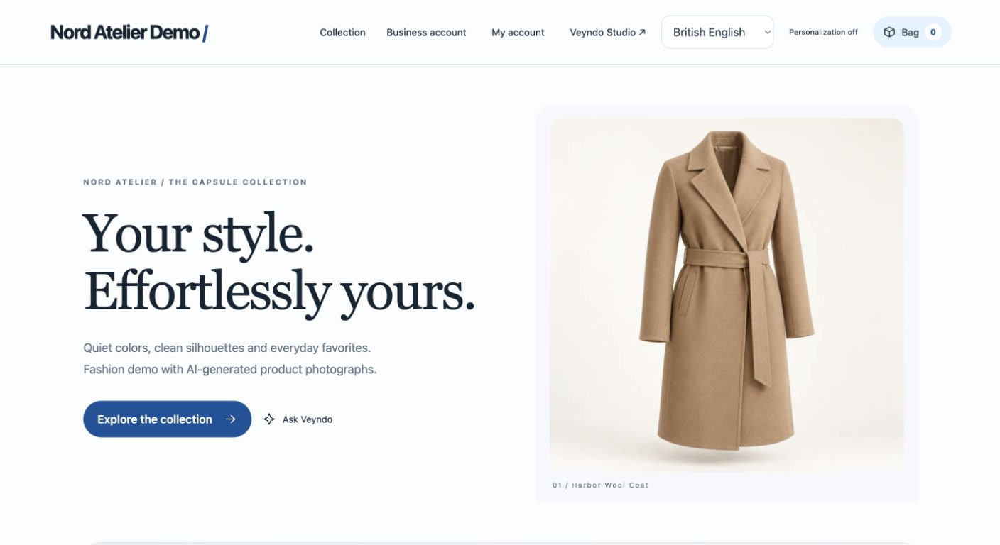

<picture>
  <source media="(prefers-color-scheme: dark)" srcset="assets/veyndo-logo-dark.svg">
  
</picture>

# Build commerce with agents

Veyndo Commerce is a Rust commerce platform for building shops, interactive
shopping experiences and merchant workflows. Run the full shop or use its
components in your own frontend, app or agent. Catalog, prices, inventory and
orders share the same commerce core.

**[Try the storefront](https://app.veyndo.ai/?shop=lumen-story-lab-15-o-98aa4751fa&lang=en-GB)** · [Run it locally](https://www.veyndo.ai/docs/quickstart.html) · [Build with the SDK](https://github.com/veyndo/sdk)

*Nord Atelier, a Veyndo demo shop. Browse the collection, ask for a recommendation and try the checkout.*

## Find the right repository

| Repository | What you can build |
| --- | --- |
| [Veyndo Commerce](https://github.com/veyndo/veyndo) | Run the shop, design the storefront in Studio and automate merchant workflows. |
| [SDK](https://github.com/veyndo/sdk) | Connect a JavaScript or TypeScript frontend to the hosted API. Read the catalog, submit a reviewed order and embed interactive MCP Apps. |
| [Apps](https://github.com/veyndo/apps) | Extend commerce with isolated Wasm logic, versioned app definitions, scoped data and background jobs. |
| [Marketplaces](https://github.com/veyndo/marketplaces) | Connect marketplace listings and import orders from Amazon, eBay and Kaufland. |

## See how it fits together

- **For shoppers.** Open an interactive product guide in the conversation, review price and delivery, and add the selected item to the cart. [Try the Product Guide](https://www.veyndo.ai/docs/product-guide-mcp-app.html)
- **For merchants.** Open a product, order or customer view from the Studio agent and review a proposed change in a private workspace. [See agentic Studio](https://www.veyndo.ai/docs/agentic-component-ui.html#open-an-a2ui-working-view-in-studio)
- **For developers.** Run a separate storefront that combines the catalog, an interactive app and a simulated purchase through Checkout. [Run the Connected Shop example](https://github.com/veyndo/sdk/tree/main/examples/connected-shop)

Veyndo is a source-available prototype. The component map explains how the services
fit together. The status page records which flows have been verified.

[Component map](https://www.veyndo.ai/docs/one-shop-components.html) · [Handbook](https://www.veyndo.ai/docs/) · [Current status](https://www.veyndo.ai/docs/status.html) · [Licensing](https://www.veyndo.ai/docs/licensing.html) · [Überblick auf Deutsch](https://www.veyndo.ai/docs/platform-overview.html)
