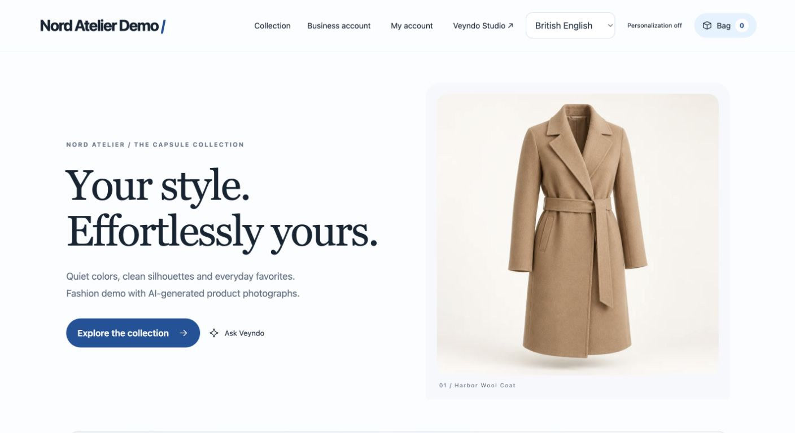

<picture>
  <source media="(prefers-color-scheme: dark)" srcset="assets/veyndo-logo-dark.svg">
  
</picture>

# Commerce that thinks and acts

**Veyndo Commerce is the AI-native commerce platform, built in Rust.** Shoppers,
merchants and their agents work on the same functions, permissions and audit trail.
One core decides price, stock and order; AI proposes, the core decides.

**[Create a shop](https://start.veyndo.ai/start)** · [Website](https://www.veyndo.ai/) · [Run it yourself](https://github.com/veyndo/veyndo#try-it) · [Handbook](https://www.veyndo.ai/docs/)

## What makes it different

- 🤖 **Agents are first-class.** 212 MCP tools, UCP cart transfer and signed offers: agents buy, sell and run the shop through the real catalog, checkout and permissions, with budgets, approvals and a stop switch.
- 🧪 **Change without fear.** A private shop twin with fictional customers and scripted attackers tries every change before it goes live.
- 🧩 **Apps that are products.** Sandboxed Wasm apps with their own data, screens, settings, jobs and actions, built by describing, editing visually or coding.
- 🦀 **One core, 22 components.** Rust components with typed ports, versioned events, OpenAPI contracts and generated TypeScript, Python and Rust SDKs.
- 🔒 **Trust you can check.** Row-level security per shop, exact decimal money, Lean-checked business rules and an upgrade test for every release.

## Find the right repository

| Repository | What you build with it |
| --- | --- |
| [**veyndo**](https://github.com/veyndo/veyndo) | The complete platform: shop, Studio, agents, apps, automation, POS, B2B and marketplaces. Start here. |
| [**sdk**](https://github.com/veyndo/sdk) | Your own storefront, checkout, buyer account or agent tool in JavaScript/TypeScript, over HTTP and MCP. |
| [**apps**](https://github.com/veyndo/apps) | App runtime and data services: isolated Wasm logic, scoped records, settings and durable jobs. |
| [**marketplaces**](https://github.com/veyndo/marketplaces) | Amazon, eBay and Kaufland listings and order import, as an independent Rust gateway. |

Veyndo is a source-available working prototype. [The current status](https://www.veyndo.ai/docs/status.html)
records what is verified · [Architecture](https://www.veyndo.ai/docs/one-shop-components.html) ·
[Licensing](https://www.veyndo.ai/docs/licensing.html) · [Überblick auf Deutsch](https://www.veyndo.ai/docs/platform-overview.html)
